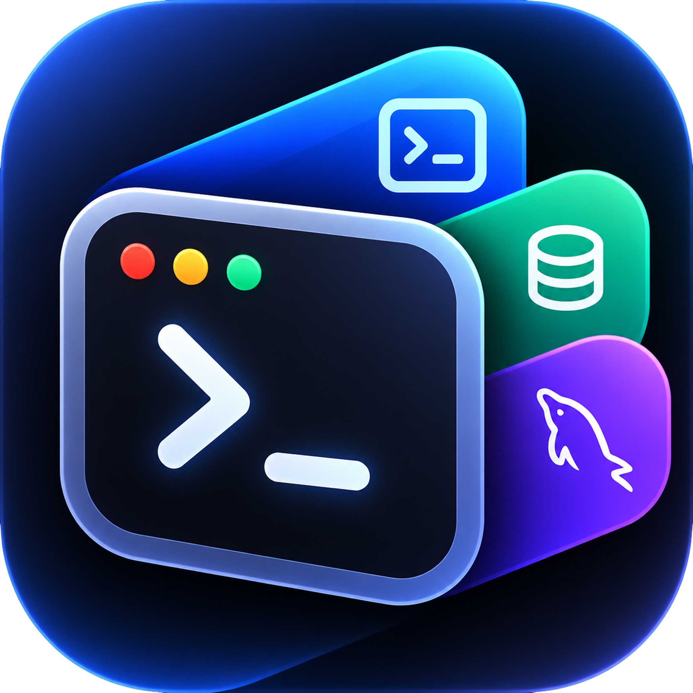

# WebiTerm

  

WebiTerm is a local macOS workstation for SSH, SFTP, MySQL, and folder boards. All application data lives in one JSON file on this device. There is no account, vault, or cloud service.

## Layout

- `webiterm/` — Tauri 2 desktop app (Rust, React, TypeScript)

## Local data

The first launch creates `~/Library/Application Support/com.webiterm.desktop/webiterm.json`. The file holds connection profiles, passwords in plain text, folders, SFTP and SSH favorites, editor preferences, and boards. Export and import copy that whole document. On Unix the file mode is `0600`.

See [docs/DEVELOPMENT.md](docs/DEVELOPMENT.md) for setup and verification commands.

Releases and in-app updates (macOS, GitHub): [docs/RELEASE.md](docs/RELEASE.md).

**Türkçe:** [docs/CALISTIRMA.md](docs/CALISTIRMA.md) — masaüstü uygulamayı çalıştırma kılavuzu.
